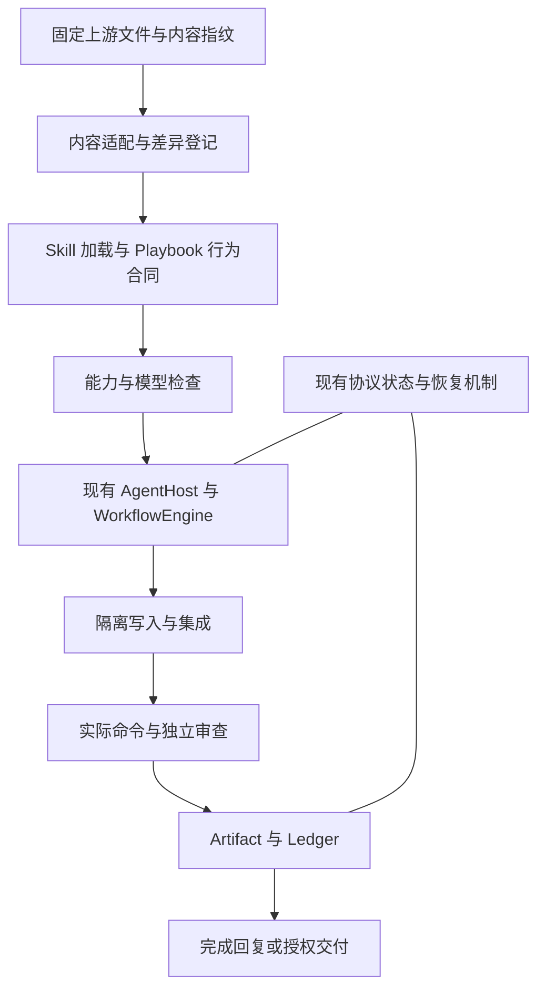

# Pi Pstack Native 2：原版对齐与原生增强交付方案

文档版本：2.2。日期：2026-10-25。状态：M1 已实施；M0 的固定目标与文件清点已生成；其余阶段待实施。

本文件评审用户提供的 1.0 Draft，并给出替代方案。M1 的源码修复已实施，范围见第 0 节。其余阶段的目标、数据结构和检查尚未实施。本文不改变 `UPSTREAM.json` 的已审核基线。

目标是让用户在 Pi 中获得 pstack 的主要工作体验，并证明具体的原生增强。这里的“一步到位”指一次确定完整目标、依赖和验收条件。代码按可验证的小批次交付。

## 0. 2.1 修订记录

### 0.1 本次交付

本次交付对应方案的 M1。
已完成 W02、W03、W04、W05 的源码修复。
两个已报告缺陷的 TODO 测试改为必须通过。
PR #9 已先修复 F01 的工具允许列表和 F02 的部分规则。
本次补齐三项内容：非只读配置的形状校验、脱敏规则集中到一个模块、更多 Token 前缀与截断和跨分块处理。

### 0.2 方案修正

执行中发现并修正了方案的三处不足。

- 8.1 节只要求把输入验证和记录构造提取为无写入操作。实际还需要把 Brief 持久化 `saveBrief` 移到物化阶段。否则构造阶段仍然写盘。实现为 `src/workflow/engine.ts` 中的 `build()` 与 `materialize()`。
- 8.2 节没有列出归属字段。实际交付的字段是 `BaselineOwner`。它包含 `briefId`、`briefRevision`，以及可选的 `workflowId`、`callKey`。系统在 `capture()` 时将字段写入产物记录。消费方必须完全匹配。工作流基线不能在工作流之外消费。系统以 `BASELINE_NOT_OWNED` 拒绝缺少归属字段的旧产物。系统不补造归属。
- 8.2 节要求测试其他 checkout。实际通过比较 `repoId`、`commitSha` 与工作区摘要覆盖此情况。拒绝原因是 `DIFF_BASE_UNAVAILABLE`。不新增 checkout 字段。

### 0.3 缺陷范围与定位

F02 的实际范围比 2.2 节写的更大。
同一条薄弱的 URL 规则也出现在 `src/artifacts/fingerprint.ts` 的远端地址归一化中。
现已将两处规则合并到 `src/runtime/redact.ts`。
截断边界的问题也已修复。
系统先对完整缓冲脱敏，再截取尾部。
发生截断时，系统丢弃第一行不完整内容。

F01 的修复方式已核对 SDK。
`customTools` 按名称覆盖内置工具定义。
因此只收紧 `tools` 允许列表即可让受限的 `read`、`grep`、`find`、`ls` 生效。
非只读配置若列出写入工具，`getProfile` 以 `PROFILE_TOOL_VIOLATION` 拒绝。

2.2 节用行号定位缺陷，例如 `src/agent/host.ts:305`。
行号会漂移。
后续条目改用符号名或测试名定位。

### 0.4 验证边界与未交付范围

W04 已有测试覆盖提交前拒绝、提交后崩溃重建两个边界。
单进程内无法注入事务内部的崩溃。
该事务的原子性由 `src/runtime/protocol.ts` 的一次写入保证。
测试不证明该事务的原子性。

本 PR 未做 W01、W06 至 W15。
F06 的校验器升级未开始。
`PARITY.json` 的 `coverage.behavioralAudit` 仍为 `not-claimed`。
本次不声明行为对齐。

本地在 Node v26.0.0 上执行 `npm run check:release` 通过。
CI 矩阵 22.19.0 与 24.x 的结果由本 PR 的 CI 给出。
方案不预设结论。

### 0.5 本次新增的回归测试文件

- `test/dispatch.test.ts`
- `test/baseline-owner.test.ts`
- `test/redaction.test.ts`

### 0.6 仍然打开的事项

- W06
- W07 至 W15
- F06

### 0.7 M0 固定目标与文件清点

`docs/upstream-target-0.15.32.json` 记录目标快照。
版本 `0.15.32`、提交 `99b609a72323b70204eab407c622f436e858e112` 来自上游自身清单。
快照含 200 个 blob 的路径、SHA、模式、大小和列表摘要。检查时不联网。

`docs/upstream-inventory-0.15.32.json` 是生成的文件清单。
`scripts/upstream/inventory.mjs` 从快照、`PARITY.json` 和本地仓库生成它。
`scripts/check-inventory.mjs` 在 `npm run check` 中重新生成并比较，检测漂移。

实测结果如下。

- 200 个文件。顶层 Skill 58 个，Playbook 23 个，Agent 2 个，清单文件 2 个，引用 33 个，脚本 48 个，自动化 12 个，文档 13 个，资源 7 个，其他 2 个。分类合计等于 200。
- 嵌套 Skill 另有 3 个，位于 `automations/benny/skills/`。它们不计入 58 个顶层 Skill。
- 处理结果：本地 76 个，仅作来源记录 2 个，不支持 1 个，待审核 121 个。
- 6 个缺少的顶层 Skill 和 3 个嵌套 Skill 都登记为待审核。
- 引用闭包发现 17 个被本地 Skill 点名的上游文件，其中包括 `skills/statechart/scripts/render.mjs` 和 `skills/poteto-mode/scripts/watch-pr/` 下的文件。
- 每条记录的 `requirements` 为 `not_recorded`，`contracts` 和 `evidence` 为 `not_run`。本次不声明任何行为通过。

结论按证据写。每个文件都有唯一去向，这一步满足。
但 121 条仍是“未审核”，所以 M0 未退出。
W07 的登记协议升级未开始，`PARITY.json` 和 `UPSTREAM.json` 未改。

### 0.8 五个缺口 Skill 的交付

本次登记 5 个 Skill。`in-your-own-words` 和 `sharpen` 之前已有本地文件，只是未登记。另外 3 个本次移植。

- `in-your-own-words`。本地版本比上游 0.15.17、0.15.23、0.15.32 三个版本的正文更完整。三份上游正文都只有一句复述要求。本地版本增加了区分“明确要求”和“你的理解”、指出影响目标的歧义、以及“本请求不授权实施”的规则。这是有意的语义适配，予以保留。
- `sharpen`。正文与上游逐字相同，只把调用写法从 `/sharpen` 改为 Pi 的 `/skill:sharpen`。
- `ketchup-video`。保留上游的截止点、回复顺序和待决定事项规则。渲染器缺失时明确阻断。本包没有视频嵌入工具，客户端不能嵌入时只返回失败说明。
- `create-formal-verification-skill`。保留上游触发条件和生成流程。生成的技能使用 Pi 的技能目录和 Agent Skills frontmatter。验证器缺失时不能声称完成。
- `maintain-formal-verification-skill`。保留上游六步流程、四类漂移、四种结果和五项报告内容。形式验证工具缺失时报告 blocked。

`statechart` 仍未支持。上游该技能有 27 个文件，含 TLA+ 与 TLC 工具链集成，以及一个 260 KB 的测试夹具。它需要独立工作包，不能算作文字移植。

`PARITY.json` 现登记 57 个顶层 Skill。目标为 58 个。`coverage.pendingTargetSkills` 列出差额，`coverage.pendingTargetReasons` 记录原因。校验器要求这个差额集合与目标快照完全一致。

### 0.9 23 个 Playbook 的行为合同

`docs/playbook-contracts.json` 登记 23 份合同，与上游 Playbook 文件一一对应。
每份合同包含触发条件、角色、工具、步骤、必须观察的行为、必须拒绝的情况和证据状态。

- 步骤按 Playbook 自身的编号列表提取。顺序和条数由 `scripts/check-contracts.mjs` 检查。
- 角色只从 Playbook 的 Steps 段落提取。`src/agent/profiles.ts` 是角色的唯一来源。工具取这些角色的工具并集。
- Steps 段没有点名任何角色时，合同记 `parentOnly: true`。23 份中有 15 份属于这种情况。
- 必须观察的行为和必须拒绝的情况来自本文 7.3 节。该表是合同来源，不另行改写。
- 每份合同的 `evidence.status` 为 `not_run`，`refs` 为空。本次不声明任何 Playbook 行为已通过验收。

新增检查：`npm run check:contracts`。它重新生成并比较，检查步骤顺序、角色存在性、工具并集、`parentOnly` 一致性和证据声明规则。
`test:upstream` 现在带 `--experimental-strip-types`，以便读取真实的角色配置。

仍未做：真实 SDK 轨迹测试和真实模型路由测试。它们需要模型与受控 Provider，属于 M2 与 M3。

### 0.10 statechart 现状

上游 `statechart` 已登记为 `ADAPTED`。`coverage.pendingTargetSkills` 为空，登记表 58 个顶层 Skill 全齐。

实现方式是固定源加生成。`skills/statechart/SKILL.md` 由 `scripts/semantics/generate.mjs` 从 `vendor/upstream/0.15.32/` 的固定快照生成。27 个脚本原样随包，blob SHA 与固定提交一致。`npm run check:semantics` 检查生成物与源是否漂移。

工具链在本机实测可用。`mise` 2026.10.19、Temurin 25、TLA+ 工具 1.7.4。TLC 能跑。

行为对齐仍未声称。上游测试套件 `npm run test:statechart` 不在发布门槛内。本机结果为 150 项，通过 127，失败 19，另 1 项需要 PID 命名空间而跳过。文件与上游逐字节相同，所以失败来自环境或上游。三类失败分别是面向其他操作系统的文件系统原子替换测试、TLC 输出解析、以及 `--against` 的字段类型判别。

`docs/statechart-port.md` 记录了完整失败清单、已声称与未声称的边界，以及三个可选后续。当前结论是：源固定与脚本随包已声称，行为对齐未声称。

## 1. 原稿质量评审

原稿适合作为方向说明。它还不能直接作为开发任务书。

值得保留的内容包括官方上游优先、Pi 原生运行时、持久恢复、产物归属、独立审查，以及真实任务对照。原稿也正确指出，文件数量和测试数量不能证明行为兼容。

需要修正的主要问题如下。

| 问题 | 影响 | 本版处理 |
|---|---|---|
| “一样或者更好”没有固定分母 | 开发者能不断缩小“核心功能”的范围 | 固定上游提交，清点整个 `pstack/`，单列必交付行为 |
| 只读工具和脱敏的现状描述错误 | 把仍存在的缺陷当成复验工作 | 按当前源码和 TODO 测试列为 P0 修复 |
| 兼容等级混合了文件内容、运行环境和证据 | `EXACT_CONTENT` 容易被误读为行为通过 | 分开记录内容处理、环境要求、行为结果和证据 |
| 只列第一批高优先级工作流 | 其余工作流没有明确交付责任 | 23 个 Playbook 全部进入验收清单 |
| 未列出新版新增 Skill 的完整差额 | 同步到新版后仍会遗漏功能 | 明确列出缺少的 6 个顶层 Skill |
| 对辅助文件的要求过于笼统 | Skill 已复制，但脚本、引用和工具仍不能使用 | 对引用闭包做检查。即逐层检查它依赖的文件和工具 |
| `compat` 与 `enhanced` 容易变成两套行为 | 增加维护成本，掩盖增强造成的退步 | 单一默认行为，增强逐项记录，实验配置单独固定 |
| 严格合同和 DAG 容易扩张到所有任务 | 简单任务需要填写过多字段，产生过多 Agent | 系统从请求生成合同，按任务需要建立执行图 |
| 里程碑缺少具体输入和阻断条件 | 完成大量文件后仍无法验收 | 为工作包指定代码位置、依赖、测试和退出条件 |
| Benchmark 对照组过多，预算未定义 | 花费高，仍不能解释差异来自哪里 | 先做同模型配对实验，再做跨平台观察 |
| 使用 Issue 的历史解释推导平台规则 | 容易把未经核对的解释写成事实 | Issue 用于定位风险，平台行为和保护设置另行核验 |

本版不以“加更多 Skill”作为主要路线。主要工作是补齐行为、消除已确认的错误，并让声明能追溯到实际运行结果。

## 2. 本次核对得到的事实

### 2.1 固定评审基线

| 项目 | 本次读取结果 | 含义 |
|---|---|---|
| 本地代码 | `ee8acfe5f65a44545a1334eae7e3a4de7f14c75b` | 本方案的源码评审基线 |
| Native 2 包 | `2333@0.6.0-preview.1` | 包名和版本来自 `package.json` |
| 已审核上游 | `0.15.17`，`978ca6e9c0e012047cd5058b8e829240336e704e` | 来自 `UPSTREAM.json`，本次未修改 |
| 已有同步候选 | `0.15.23`，`837067b75aa20ab58d7b2a2f6c0531e37118c596` | 已有扫描报告，不代表已完成移植 |
| 本版目标上游 | `0.15.32`，`99b609a72323b70204eab407c622f436e858e112` | 本次从官方仓库读取并固定的目标 |
| 目标完整范围 | `pstack/` 下 200 个 Git blob | Git blob 指 Git 记录的文件内容对象。数量包含文档、图片和脚本 |
| 目标顶层入口 | 58 个 Skill，23 个 Playbook，2 个 Agent 文件 | 按固定提交的文件路径统计 |
| 当前登记范围 | 52 个 Skill，23 个 Playbook | 当前登记不声称已完成行为审核 |

上游目标是本次读取的快照。它不代表实施时仍是最新提交。实施时若更换目标 SHA，必须重新生成清单并审核差额，不能只修改版本号。[S01] [S02] [S03]

Michael 的移植是参考实现。其 `tools/upstream.json` 当前还管理 `cursor-team-kit` 和 `thermos`。这些组件不能混入本项目对官方 `pstack/` 的覆盖率分母。参考实现的策略修改也不能自动成为原版规范。[S04]

### 2.2 当前代码中的具体缺口

| 编号 | 已核对的位置 | 本次结论 |
|---|---|---|
| F01 | `src/agent/host.ts` 的 `createAgentSession()` 工具参数 | 只读子 Agent 仍传入 `tools: []`，同时依赖 `customTools` 提供读取工具 |
| F02 | `src/verification/runner.ts` 的 `command()` 脱敏 | 脱敏仍要求 URL 用户信息含冒号，且没有处理已报告的裸 Token 前缀 |
| F03 | `test/e2e/reported-defects.test.ts` | F01 和 F02 仍是两个 TODO 测试。不能算作通过 |
| F04 | `src/program/coordinator.ts:40`、`src/workflow/engine.ts` | Workflow 写入独立 JSON，Program Unit 写入协议文件。两者不共享原子提交 |
| F05 | `src/artifacts/fingerprint.ts` 的 `capturedBaseline()` | `capturedBaseline()` 校验 ID 和指纹，没有校验消费任务的归属 |
| F06 | `scripts/upstream/parity.mjs` | 当前检查明确禁止声称文件级和行为级审核已完成。新增证据协议需要同步升级此检查 |
| F07 | `scripts/check-e2e.mjs` 的 `playbooks` 层 | 主要运行 `docs/parity.test.mjs` 的 10 项检查，不是 23 个 Playbook 的真实模型验收 |
| F08 | `src/templates/build.ts` | 已有 Arena、Swarm、Review、Autopilot 模板。存在模板不等于执行了对应上游 Playbook |
| F09 | `docs/upstream-sync/VALIDATION.md` | 已记录 Coordinator 在负载下出现间歇失败。原因尚未确定，不能靠重跑通过关闭问题 |
| F10 | `scripts/benchmark.mjs` | 已有 20 个小型修复题和运行器，不应从零重建，也不能把这些题当作全面对照研究 |

Issue #2、#3、#5、#7 在本次读取时均为 open。问题状态只是辅助证据。修复是否存在，以被评审提交的源码和可运行测试为准。[S05] [S06] [S07] [S08] [S09]

### 2.3 本次实际执行的检查

| 命令 | 结果 | 证明范围 |
|---|---|---|
| `npm run check:parity` | 通过 | 52 个 Skill 和 23 个 Playbook 的当前登记一致 |
| `npm run check:playbooks` | 10 项通过 | 当前文档、加载和 PR 正文规则检查通过 |
| `npm run test:e2e:offline` | 7 项通过，2 项 TODO | 已有离线检查通过。两个已报告缺陷仍未转成通过用例 |

本次 Node.js 为 `v26.0.0`。仓库 CI 矩阵为 `22.19.0` 和 `24.x`。本次结果不替代这两个版本的发布验证。

离线测试首次受本机沙箱限制，监听 `127.0.0.1` 时返回 `EPERM`。允许本机回环监听后，完整离线层得到上表结果。这是测试环境限制，不能记成产品功能失败。

本次没有运行真实模型、真实 GitHub 写入、完整发布检查或性能对照。没有新增任何功能兼容声明。

## 3. 产品目标和完成定义

### 3.1 “和原版一样”的定义

用户以相同目标启动工作。系统选择相同类别的 Playbook，遵守原版要求的顺序、角色、验证和交付条件。Pi 用自己的工具完成这些动作。

兼容范围分为三类。

| 范围 | 发布要求 | 不能采用的处理 |
|---|---|---|
| Pi 能完成的 pstack 行为 | 实现并通过对应行为合同 | 仅复制文件就标记支持 |
| 需要模型、浏览器、取证源或验证工具的行为 | 在声明支持的配置中完成实际验证。缺少依赖时明确阻断 | 把“能报缺少依赖”算作功能已经实现 |
| Cursor 专有实现方式 | 登记原生等价路径，或公开列为限制 | 把普通文件、脚本或缺失的 Pi 代码归类为 Cursor-only |

本项目的发布声明采用“固定基线下的已验证语义对齐”。语义对齐指用户可观察的行为符合合同。它不承诺不同模型生成相同文本或相同代码。

“全量对齐”要求约定范围内没有未实现的必需行为。若还有缺口，发布材料必须列明缺口，并使用“部分对齐”。

### 3.2 “更好”的定义

原生增强必须有具体结果。至少验证以下能力。

1. 进程中断后，系统保留已确认完成的节点和证据。
2. 指令、产物或远端状态变化后，系统拒绝复用过期验收。
3. 并行写入经过隔离和集成，最终产物重新验证。
4. 用户能查到阻断原因、已完成步骤和下一项动作。
5. 真实任务对照公开成功率、成本、耗时和人工干预，包含失败样本。

这些结果支持具体增强声明。没有与 Cursor 原版进行可比实验时，不使用“全面优于原版”的表述。

### 3.3 默认用户体验

用户完成 `/setup-pstack` 后，用 `/poteto-mode <任务>` 开始工作。系统从请求、仓库和现有指令生成执行合同。用户只处理会改变产品目标、权限或不可恢复动作的决定。

简单任务保留直接执行路径。原版要求的独立审查仍必须执行。系统不因任务简单而取消原版的必需步骤，也不额外为每次文字修改创建完整多 Agent 流程。

用户通过现有 `/pstack-workflows`、`/pstack-agents` 和 `/pstack-runtime` 查看进展。完成回复包含实际改动、验证结果、未完成项和下一步。系统不能要求用户先阅读 Ledger 才能理解结果。

### 3.4 本轮不做的工作

- 不替换 Pi 的模型 SDK、会话系统或压缩机制。
- 不重写现有 DAG 和持久化层。
- 不以新目录结构或包重命名阻挡行为对齐。
- 不承诺跨主机调度、永久后台服务或外部系统的全局事务。
- 不从模型评分、文件数量或局部基准推导全面优势。

## 4. 交付范围必须覆盖完整上游

### 4.1 文件与依赖范围

对固定提交下的 200 个文件逐项登记处理结果。处理类型为直接保留、机械适配、语义适配、原生替代、仅作来源记录，或明确未支持。

文档和图片不一定全部随包发布，但必须说明去向。被 Skill 引用的脚本、模板、参考文档和 Agent 文件必须能在安装包中解析。扫描到依赖名称不等于依赖可用。

清点范围包括以下内容。

- 58 个顶层 Skill 和 23 个 Playbook。
- `poteto-agent` 和 `comment-sicko` 的角色规则。
- `poteto-mode/scripts/` 下的计划检查、编排和 PR watcher。
- `statechart/scripts/` 及相关运行依赖。
- `automations/benny/` 的流程、模板和嵌套 Skill。
- 官方运行时适配说明和用户指南。
- `cursor-team-kit`、`thermos`、浏览器、MCP、模型和 GitHub 工具等外部依赖。

`automations/benny/` 中的嵌套 Skill 单列。它们不包含在“58 个顶层 Skill”中。不得因此漏掉它们，也不得重复计数。[S02]

### 4.2 当前缺少的 6 个顶层 Skill

以下差额来自目标清单与当前 `PARITY.json` 的名称比较。

| Skill | 必须交付的行为 | 关键验收 |
|---|---|---|
| `in-your-own-words` | 用户显式调用后复述目标和问题 | 不提前执行任务，不擅自扩充目标 |
| `sharpen` | 深化请求并返回改写后的提示 | 保留属于用户的选择，不执行改写后的任务 |
| `ketchup-video` | 根据真实工作材料生成静音视频，并保留待决定事项 | 视频可播放。渲染失败时执行上游规定的降级行为 |
| `create-formal-verification-skill` | 针对实际代码生成可重跑的形式化验证 Skill | 工具确实运行，结论标明模型范围和输入边界 |
| `maintain-formal-verification-skill` | 检查代码与验证模型是否漂移 | 能区分同步、更新、代码错误和阻断 |
| `statechart` | 按上游流程生成状态图和对应验证材料 | 运行所需脚本。图、模型和实际工具结果一致 |

形式化验证指用明确模型和工具检查性质。模型通过不代表全部真实程序已经得到证明。

这些能力需要额外工具时，由能力检查给出安装要求。扫描上游和普通启动不能自动下载、安装或执行这些工具。[S10] [S11] [S12] [S13] [S14] [S15]

### 4.3 原版专有功能也要给出处理结果

`make-bot-ui`、Cursor cloud verifier、Bugbot、Cursor Automations 和内置 PR 工具分别登记。每项记录原版要求、Pi 替代、外部依赖和不可等价部分。

例如，只读本地 Reviewer 能替代部分审查角色，但不能自动证明拥有独立云端执行环境。若 shipping 合同需要独立运行验证，替代实现必须在独立 checkout 中运行实际控制工具。

Benny 可采用“用户显式启动的 Runner 加事件输入适配”方案。事件来源、去重键、停止方式和外部操作授权必须明确。若本轮未实现，Benny 保持未支持，不能用已有 `/pstack-loop` 代替其完整行为。

## 5. 架构决策

### 5.1 保留一套运行时和一套默认行为

默认行为以已审核 pstack 为准。持久化、产物身份、权限和日志完整性属于公共基础能力。

本轮不新增用户可选的 `compat` 和 `enhanced` 顶层模式。增强使用明确配置项，并记录到每次运行中。实验使用固定配置，比较某项增强启用前后的结果。

如果增强改变原版的决策、角色或交付条件，该差异必须登记。不能把差异藏在“更严格”或“更安全”的概括中。

### 5.2 在现有模块上补齐行为



执行图只描述需要调度的工作。任务出现新证据时，可以修订未开始的节点。修订必须形成新计划版本，并重新检查依赖和权限。不得修改已完成步骤的历史记录。

### 5.3 每类数据只有一个权威来源

| 数据 | 权威来源 | 生成内容 |
|---|---|---|
| 已审核上游版本和提交 | `UPSTREAM.json` | 版本展示、同步起点 |
| 文件映射、行为合同和适配差异 | 升级后的 `PARITY.json` | `PARITY.md` 和兼容诊断 |
| 候选同步和审查过程 | 现有 `docs/upstream-sync/` 报告 | 任务包和候选提案 |
| 执行、授权和证据 | 现有运行时协议状态及证据文件 | 恢复、诊断和验收结果 |

本轮不另外维护一份重复事实的 `FORKS.json`。参考 Michael 的差异登记方式，将差异作为 `PARITY.json` 中的记录。若后续需要拆文件，拆分后的记录仍由同一校验器生成和检查。[S04] [S16]

## 6. 兼容记录和证据协议

### 6.1 分开记录四件事

每项记录包括以下字段。字段名是拟议协议，不是现有 API。

| 字段 | 内容 |
|---|---|
| `source` | 上游完整 SHA、路径、blob SHA |
| `port` | 本地路径、内容处理类型、转换规则版本、差异说明 |
| `requirements` | 工具、模型角色、环境、权限和外部组件 |
| `contracts` | 对应行为合同 ID 和验收要求 |
| `evidence` | 实际运行结果、目标产物、配置摘要和日志引用 |

`port` 中的“原文保留”只描述文件内容。它不推导行为通过。

行为状态使用 `not_run`、`passed`、`failed`、`blocked` 和 `stale`。环境缺失是 `blocked`，不能记为 `passed`。旧产物的成功是 `stale`，不能记为当前成功。

### 6.2 证据按维度记录

| 维度 | 能证明什么 | 不能证明什么 |
|---|---|---|
| 静态检查 | 文件、引用、配置和来源完整 | 模型正确执行工作流 |
| 模块与故障测试 | 状态转换和特定失败路径 | 全部 SDK 和供应商行为 |
| 实际 SDK 加本地 Provider | 会话、工具和编排真实接通 | 真实模型会选择正确动作 |
| 真实模型任务 | 指定模型和配置下的行为结果 | 所有模型和所有任务都兼容 |
| 真实外部服务 | 指定 GitHub、浏览器或取证配置可用 | 其他权限与部署环境相同 |
| 配对对照 | 特定实验中的差异 | 自动证明上述所有维度 |

比较实验不是更高一级的兼容证明。每个维度单独记录。一次失败不能被同一行中另一次成功覆盖。

### 6.3 更新校验器和发布声明

现有校验器接受 `ADAPTED`、`CURSOR_ONLY` 和 `PENDING_PORT`，并要求行为审核保持 `not-claimed`。新协议必须与校验器、生成报告和迁移逻辑一起交付。

至少增加以下检查。

- 上游所有文件都有处理结果，且没有重复或越界映射。
- 本地适配和上游文件指纹一致，差异记录没有失效。
- 每项必需行为都有合同，合同指向存在的实现和测试。
- 必需测试的 `skip`、`todo`、缺失和失败都会阻断对应发布声明。
- 修改上游 SHA、合同、模型路由或产物后，相关证据重新判定是否有效。
- 文档中的支持状态由登记数据生成，不手工写“全部支持”。

## 7. Playbook 行为合同与路由

### 7.1 合同描述行为，不匹配回答关键词

每份合同至少包含触发条件、输入、必需步骤、步骤顺序、允许分支、角色、工具、输出和失败条件。

例如 `bug-fix` 合同必须验证原始复现、根因证据、实现委派、同一控制方式下的修复验证，以及满足权限条件的 PR 交付。廉价本地测试存在时，才要求对应的失败测试先行步骤。不得把所有缺陷都改成无条件 TDD。[S17]

合同既保留上游原文引用，也提供机器能判断的约束。机器约束不声称完整理解自然语言。复杂结论仍需要实际产物和独立审查。

### 7.2 测试必须观察真实动作

测试读取工具调用、子会话身份、仓库状态、命令退出码和产物。只在输出中出现 `reproduce` 或 `verify` 不算执行了该步骤。

受控 Provider 测试验证执行机制。真实模型测试验证路由和遵循指令。两类测试不能互相替代。

路由至少覆盖正常请求、模糊请求、显式指定 Playbook、已有中断任务和用户中途纠正。只允许手动调用的 Skill 必须有负向用例，证明系统不会自动执行。

### 7.3 23 个 Playbook 的最小行为清单

| Playbook | 必须观察的行为 | 必须拒绝的情况 |
|---|---|---|
| `authoring-a-skill` | 按实际运行环境生成并验证 Skill | 文件存在但无法加载或调用 |
| `autonomous-run` | 在授权范围内持续推进，保留停止条件 | 把自治授权扩大到未授权外部动作 |
| `autopilot-full` | 每个 PR 有 Owner，代码变更后重新验证 | 旧 Head 的审查被新代码复用 |
| `autopilot-stack` | 正确建立线性依赖和父分支，交付有序栈 | 把所有子 PR 直接指向 trunk |
| `babysit` | 根据请求选择模式，读取 CI 和审查状态 | 创建 PR 后未经触发就自动开始轮询 |
| `bug-fix` | 复现、缩小根因、实现、原始场景验证 | 错误场景或无法判断的结果被记为修复成功 |
| `eval` | 固定样本和评价规则，保留盲评与失败 | 修改规则后继续使用旧分数比较 |
| `feature` | 从数据结构和需求建立可运行行为 | 仅凭实现者总结认定需求满足 |
| `hillclimb` | 逐次记录假设、基线、测量和接受决定 | 无可比测量就保留所谓优化 |
| `investigation` | 从实际证据回答，保留来源状态 | 未经任务授权修改仓库或远端 |
| `multi-phase-plan` | 每阶段有目标、依赖、产物和验收 | 前一阶段未验收就把后续阶段标为完成 |
| `opening-a-pr` | 按目标基线确定 PR 状态、父分支和正文 | 在权限或验证不足时声称已创建 PR |
| `orchestrate` | 维护长期任务、指令版本和阶段交付 | 旧指令下的孤立 Workflow 自动恢复 |
| `pause-safely` | 记录在途动作、产物和恢复条件 | 把暂停视为外部副作用已撤销 |
| `perf-issue` | 用相同场景建立基线并解释限制因素 | 改变工作量后宣称性能提升 |
| `prototype` | 用最小实验回答具体设计分歧 | 把试验代码默认为生产实现 |
| `refactoring` | 保留明确的外部行为并运行验证 | 结构改动中混入未经授权的需求变更 |
| `runtime-forensics` | 读取运行中证据并确认触发机制 | 仅凭静态推测关闭运行时问题 |
| `session-pickup` | 从当前代码、状态和历史证据恢复任务 | 仅依赖旧摘要继续写入 |
| `shipping` | 独立验证，按底部连续已验证区间交付并读回 | CI 绿、排队或启用 auto-merge 被当作已合并 |
| `trace-forensics` | 分析指定采样材料，标明采集条件和局限 | 在材料不支持时推断根因已确认 |
| `visual-parity` | 在固定视口和状态下对比真实图像 | 用组件存在或文字总结证明视觉一致 |
| `worktree-cleanup` | 检查归属、改动和合并状态，再执行已授权清理 | 强制删除未知或含未保留修改的工作区 |

本表是最小交付范围。实施时仍须从固定上游逐份提取完整合同。不能把表中的一句话当成全部上游要求。

## 8. 先修复执行正确性

### 8.1 Workflow 与 Program Unit 原子登记

当前 Workflow 和 Program 使用不同文件。仅在 `create()` 外再包一层锁，不能形成跨文件原子提交。

本轮采用持久派发记录。派发记录是完整的创建描述，含固定 Workflow ID、节点和 Brief 输入摘要、Owner、Program Unit、指令版本及派发身份。

先把 Workflow 的输入验证和记录构造提取为无写入操作。构造阶段还必须停止写入 Brief。当前 `saveBrief()` 也写盘，因此 Brief 持久化与 Workflow 文件写入一起移到物化阶段。实现位置是 `src/workflow/engine.ts` 的 `build()` 与 `materialize()`。然后复用 `src/runtime/protocol.ts` 的事务 envelope，在同一提交中保存完整派发记录、必要的 Brief 内容和 Unit 关联。事务 envelope 指一次提交同时保存状态和对应事件。

提交后，根据派发记录创建独立 Workflow 文件。此操作必须可重复，且每次得到同一个逻辑 Workflow。提交后崩溃但文件尚未创建时，恢复从派发记录重建。文件存在但派发记录不存在时，Program 路径拒绝执行。

AgentHost 启动前核对已提交派发记录、Workflow 文件和 Unit 的身份。恢复还要检查 Owner、Brief 版本和指令版本。孤立记录进入隔离状态，不能仅凭 `parentSessionId` 恢复。

该方案不把两次文件写入称为一个事务。原子提交的是派发意图和 Unit 归属，后续文件创建按该意图恢复。普通独立 Workflow 保留自身创建路径，不假装属于 Program。

验收必须在登记前、提交中、提交后和 Agent 启动前注入崩溃。修改指令后恢复，旧任务不得继续以当前任务身份运行。重复恢复不得创建第二个逻辑派发。[S06]

### 8.2 Baseline Receipt 绑定消费任务

Baseline Receipt 是修改前快照的归属记录。它由运行时在允许写入前创建。

记录至少绑定仓库和 checkout、Workflow、节点、任务 Brief 及其 revision、派发身份、捕获阶段、产物 ID 和指纹。交付形状是 `BaselineOwner`，字段为 `briefId`、`briefRevision`，以及可选的 `workflowId`、`callKey`。字段在 `capture()` 时写入产物。消费方必须完全匹配。带 `workflowId` 的基线不能在工作流之外消费。缺少归属字段的旧产物以 `BASELINE_NOT_OWNED` 拒绝，系统不补造归属。

恢复进程不产生新的逻辑派发身份。业务重试若改变了基线或合同，必须显式建立新身份。验证器根据当前调用解析允许消费的基线，不能只接受调用方给出的任意 Artifact ID。

必须测试其他 Workflow、其他 Brief revision、修改后捕获、其他 checkout、缺失字段和合法恢复。保留同任务合法基线的正向测试。其他 checkout 由 `repoId`、`commitSha` 与工作区摘要比较覆盖，拒绝原因是 `DIFF_BASE_UNAVAILABLE`，不新增 checkout 字段。[S07]

### 8.3 只读工具与秘密信息

只读 Agent 需要真实可用的 `read`、`grep`、`find` 和 `ls`。具体 SDK 参数按实际工具注册协议设置，不能只改提示词。

测试要求模型实际调用读取工具并得到文件内容。只检查工具名称仍不够。测试还要拒绝写入、越界路径和越界符号链接。

日志在写盘前脱敏。覆盖 URL 用户信息、有标签和裸 Token、Header、环境赋值，以及跨输出分块的秘密。规则集中在 `src/runtime/redact.ts`。`src/artifacts/fingerprint.ts` 的远端地址归一化使用同一套规则。先对完整缓冲脱敏，再截取尾部；发生截断时丢弃第一行不完整内容，避免留下半个秘密。测试使用合成秘密，禁止把真实凭证放进样本。

F01 和 F02 修复后，必须移除 TODO，并把 `scripts/check-e2e.mjs` 的对应预期状态从 TODO 改为必需通过。源码、构建包和安装包使用同一组行为验收。[S05]

### 8.4 处理间歇失败

复现已记录的 Coordinator 失败，区分产品并发缺陷、测试共用状态和外部负载。先保留失败证据，再修复根因。

用固定种子和受控调度重现目标交错。相关回归通过后，在目标 Node 版本重复执行。重跑成功只说明那次成功，不说明缺陷消失。

## 9. 状态、验证和恢复的不变量

### 9.1 分开记录三类状态

执行状态、验收状态和外部动作状态分别记录。不能用一个巨大的状态枚举混合三类事实。

| 类别 | 示例状态 | 关键区别 |
|---|---|---|
| 执行 | queued、running、completed、failed、cancelled | `completed` 仅表示执行结束 |
| 验收 | not_run、passed、failed、blocked、stale | `passed` 必须对应当前产物和合同 |
| 外部动作 | planned、in_flight、confirmed、unknown、refused | `unknown` 不允许无条件重试 |

每次状态变更记录版本。旧 Runner 或旧会话不得继续提交当前派发的结果。现有 Lease 和 fencing 机制继续承担单机所有权约束，不扩张为跨主机协议。

### 9.2 必须一直成立的规则

1. 依赖尚未满足时，不启动节点。
2. 只有已提交的派发记录能启动 Agent。
3. 所有证据都绑定产生它的合同、环境和产物。
4. 已完成节点恢复后不重新派发。运行中断且完成情况未知的动作先核对实际状态。
5. 指令或 Brief 变化后，未开始的节点重新审核。在途动作按其权限和副作用处理。
6. 并行 Writer 使用不同 Worktree。最终交付物经 Integrator 形成后重新验证。
7. 取消表示停止后续工作并请求终止在途工作，不表示已撤销副作用。
8. Agent 文本不能写入确定性 PASS，也不能覆盖命令失败。
9. 证据丢失、产物变化或合同修订后，旧验收不能继续证明当前任务完成。
10. 同一 checkout 的最终验证期间，其他 Writer 不得继续修改被验收输入。

### 9.3 Reviewer 与运行验证分工

Reviewer 检查问题和证据。独立运行验证者在独立 checkout 中使用获准控制工具复现行为。确定性 Runner 执行具体命令并保存退出状态。

Reviewer 不能直接修改被审查代码。测试命令需要写入构建目录时，由专用 Runner 在隔离 checkout 中执行。不能给“只读 Reviewer”开放任意 shell，再把提示词当作权限隔离。

独立性记录作者会话、审查会话、实际模型、是否看过作者总结、checkout 和验证输入。不同模型不是完全独立的证明。原版明确要求多模型时，不得静默替换成同一模型。

### 9.4 明确本地信任范围

现有协议文件、进程和获准命令处于本机可信范围内。指纹和日志摘要检测误用与变化，不抵御已能任意重写本机状态的攻击者。

Worktree、路径检查和 argv 白名单都不是操作系统沙箱。不可信仓库脚本需要外部沙箱。本文不新增一套签名系统来掩盖同一用户进程可改写全部状态的事实。

## 10. 模型、上下文和预算

模型路由保留用户已有配置。角色选择、模型支持的推理等级和所需独立性在派发前检查。

显式要求的模型或能力不可用时，阻断并给出具体缺失项。只有合同允许且已有用户配置授权时，才选择替代模型。记录实际选择，不能把替代后的结果标成原配置结果。

Handoff 包含目标、当前计划版本、已完成节点、产物和证据引用、未解决问题、在途副作用和下一项动作。摘要用于理解任务。恢复仍读取实际状态。

外部证据分别记录 available、empty、unavailable 和 inconclusive。父 Agent 传来的材料标为传入证据，不能标为子 Agent 独立检索结果。

预算包含并发、运行时间、调用数和 Token。费用分别记录供应商实际值与估算值，缺失时为 unknown。系统按任务重要性控制新派发，并为在途请求预留估算额度。

达到预算后停止新派发，并处理在途请求。系统不承诺供应商账单的绝对上限。因预算停止时保存可恢复状态，不生成完成结论。

## 11. GitHub 交付必须保持原版意图

### 11.1 授权与行为分开

记录用户已授予的操作范围。授权至少区分本地修改、推送、创建 PR、评论、合并、共享分支强推、部署和删除。

已有会话授权在范围内继续有效。系统不因内部阶段切换重复询问。准备具体改动和验证结果后，才请求仍缺少的授权。

对上游要求的交付步骤，若权限或工具不足，记录“交付被阻断”。不能把“代码已经验证”和“PR 已交付”混成一个完成状态。

### 11.2 Shipping 的验收合同

保留上游的独立逐 PR 验证、从底部连续通过区间交付、逐项读回和停止于已验证上界的要求。[S18]

Native 2 使用更严格的默认失效规则。Head、Base、合同或验证输入改变后，重新验证受影响的产物。上游允许部分 patch 等价复用时，本轮先登记为有意差异，不仓促加入不完整的等价证明。

本地 `--match-head-commit` 类约束只防止部分 Head 竞争。Base、审查和 CI 的最终约束仍需要服务端保护。诊断读不到保护设置时，应报告 unknown，不能宣称服务器约束已生效。

### 11.3 外部动作恢复

每次动作先保存意图和操作身份，再请求远端，最后读回确认。合并排队、设置 auto-merge 和实际 merged 分开记录。

恢复时优先查询远端。已经确认成功的动作不重发。状态未知的动作先对账，再决定是否允许重试。授权仍有效也不能绕过当前产物和远端状态检查。

必须覆盖创建 PR 返回前崩溃、合并成功后本地落盘失败、Head 变化、Base 变化、审查变化、授权撤销、重复请求和 PR 栈依赖变化。

Issue #7 说明需要验证过期分支和检查定义的风险。其历史解释不直接作为 GitHub 当前事件语义的规范。实施时按实际事件、测试 SHA 和保护设置重现，不能使用运行不可信 PR 代码的高权限流程来规避检查问题。[S08]

## 12. 上游同步使用已有工具继续扩展

现有扫描、任务包、验证、准备 Worktree 和候选提案已经实现。新工作以这些模块为起点，不建立第二条同步流水线。

同步过程分为以下状态。

```text
固定候选提交
    → 生成完整文件差异和依赖差异
    → 建立适配与行为合同任务
    → 实施候选改动
    → 在候选产物上运行检查
    → 审核差异与证据
    → 合并代码并同步提升已审核基线
```

扫描和提案不能提升基线。代码、兼容登记、证据索引和 `UPSTREAM.json` 必须在同一审核交付中保持一致。

源码转换优先采用可重复的机械规则。规则不能只替换工具名称，必须保留动作、权限、返回结果和失败条件。手工语义适配记录原因、位置和合同。

复现目标扫描使用现有命令。以下命令是后续实施步骤，本次未执行。

```bash
npm run upstream:scan -- --candidate-ref 99b609a72323b70204eab407c622f436e858e112
```

后续 `upstream:plan`、`upstream:verify` 和 `upstream:prepare` 使用扫描实际返回的报告路径。报告名不得预先编造。

## 13. 验证策略与发布门槛

### 13.1 三组必需验收

| 组别 | 运行内容 | 门槛 |
|---|---|---|
| 每次代码变更 | 来源、链接、合同、模块、故障、SDK、构建、安装包和现有发布检查 | 对应必需用例全部执行，没有 skip、todo 和未解释失败 |
| 发布候选 | 在支持的 Node 和 Pi SDK 上运行真实模型代表任务及全部声明的行为合同 | 公布模型、配置、任务、产物和每次结果 |
| 外部能力发布 | 真实受控 GitHub、浏览器、取证与新增工具验收 | 对每种声明支持的集成保留实际运行证据 |

每个 Skill 的每条必需合同都有正向证据。高风险合同同时覆盖失败或缺少依赖的路径。24 个原则以对应任务中的行为断言验收，不能仅检查文本存在。

23 个 Playbook 都必须有实际 SDK 轨迹测试。宣称真实模型支持时，还要有指定配置下的任务证据。一个任务可覆盖多个合同，但证据必须逐项关联。

### 13.2 防止测试只证明自己

验收工具要运行负向控制。例如删除独立审查步骤、交给错误 Baseline、改变 Head、隐藏命令失败或复用旧收据。检查必须因对应原因失败。

受控 Provider 不能预先给出全部成功文本，再由系统统计“成功”。测试要核对实际文件、工具、命令和状态。输出报告必须保留没有运行、被环境阻断和实际失败的区别。

### 13.3 故障与安装矩阵

故障注入覆盖登记、启动、工具调用、验证、日志写入、授权消费和远端确认的前后边界。所有测试有独立状态目录和仓库，不能共享全局测试写入状态。

先在现有 Node `22.19.0` 与 `24.x` 矩阵完成验证。Pi SDK 至少包含最低声明版本和固定的主要测试版本。浮动版本用于发现变化，发布证据保存实际版本和 lockfile 摘要。

源码、`dist/`、npm tarball 和独立 consumer 的结果一致。扩展入口、CLI、公开 API、Skill 文件、引用脚本和来源说明都属于安装包验收范围。

### 13.4 所有检查通过仍不能替代声明审核

`npm run check:release` 继续保留。新增合同和证据检查纳入相应入口，不删除既有 Gate 来换取绿色结果。

README、`PARITY.md`、验收报告和诊断输出必须使用同一证据索引。旧验收报告保留日期与历史身份，不能继续作为当前版本的默认证明。

## 14. 用可控实验判断增强是否有效

### 14.1 复用已有基础

保留 20 个小型修复题，作为运行器和局部行为冒烟检查。新增真实仓库任务、跨模块改动、并行集成和中断恢复题。

优先比较两组。

- A 组：Pi 单 Agent，启用相同工具和同一模型，使用固定 pstack 指令。
- B 组：Native 2，使用同一模型、任务和工具，启用被评估的编排增强。

Michael on Pi 可作为独立第三组。Cursor 原版作为额外对照。模型或平台无法固定时，分别报告观察结果，不归因于编排本身。

### 14.2 分两步运行

先用 8 个代表任务试跑，检查评分能否识别已知失败，估计时间和费用。修正评分器后冻结正式任务与评分规则，试跑结果不混入正式结论。

正式实验的初始预算为 30 个任务、2 组、每任务重复 3 次，共 180 次运行。任务分成简单修复、跨模块修改、新功能、并行集成和恢复交付 5 类，每类 6 个。该数量是执行预算，不是统计充分性的证明。

试跑后由任务负责人登记预计费用、单次上限和总上限。预算不足时缩小公开声明，不能只保留成功样本。真实远端写入使用专用测试仓库和限定授权。

### 14.3 预先登记评价规则

主指标是外部检查确认的任务成功率。次指标是回归、虚假完成、人工干预、恢复成功、重复副作用、总耗时、Token 和费用。

费用同时报告每次尝试和每次成功的成本。失败、超时、重试和环境阻断都保留。模型版本、推理配置、工具、初始提交、缓存和执行顺序固定或记录。

使用配对差值和区间报告结果。对模型随机性和任务难度做分层。样本不足时输出 inconclusive，不宣称非劣或更优。

产品上接受的成功率下降幅度、成本上限和最小有用改进，在正式实验前确定。不能看完结果再设门槛。确定性的恢复和错误证据拒绝能力单独报告，不与任务成功率平均成总分。

### 14.4 允许发布的结论

结论示例是“在指定任务和配置中，中断后恢复完成率为某值，重复合并次数为某值”。实际数值由实验生成。

只有对应配对证据成立时，才发布某项增强优于对照的结论。原生功能已实现但未完成对照时，使用“具备此能力，比较效果尚未确定”。

## 15. 实施工作包与依赖

### 15.1 完整目标固定，按验收推进

| 阶段 | 目标产物 | 退出条件 | 后续依赖 |
|---|---|---|---|
| M0：固定事实和合同 | 目标清单、差额、全部行为合同、能力要求 | 200 个文件都有分类。58 个 Skill、23 个 Playbook、2 个 Agent 及嵌套能力均有去向 | 所有后续阶段使用同一目标。清单现状见 0.7 节，行为合同尚未开始 |
| M1：恢复和证据正确 | F01 至 F05 修复，间歇失败调查 | 缺陷有目标复现和正向回归。P0 TODO 清零，故障路径通过 | 可靠编排和交付依赖此阶段 |
| M2：完整行为移植 | 全量内容、脚本、引用、工具映射和路由 | 支持范围内所有必需合同通过 SDK 验收，差异明确 | 真实模型验收依赖此阶段 |
| M3：真实任务与原生增强 | 真实模型、GitHub、恢复、预算和诊断证据 | 每项公开声明都指向实际证据，受控集成通过 | 发布候选和比较实验 |
| M4：发布与对照 | 安装矩阵、迁移报告、完整实验和发布说明 | 最终完成清单满足。未证明的优势不进入发布文案 | `1.0.0` 或继续 Preview |

M0 的清点与 M1 的缺陷修复可以同时推进。不能因上游内容移植而延后已确认的秘密泄露修复。M1 未退出前，不发布声称可靠恢复或完整独立验证的新版本。

版本号不决定阶段完成。只有退出条件满足，才提升对应声明。无需为了经过 `0.7`、`0.8`、`0.9` 而制造中间架构。

### 15.2 可直接交给实现者的工作包

| ID | 修改位置或产物 | 依赖 | 必需验证 |
|---|---|---|---|
| W01 | 固定目标扫描，完整文件和依赖登记 | 无 | 清单与 Git tree 一致，重复生成稳定 |
| W02 | `src/agent/host.ts`、只读工具、缺陷测试 | 无 | 实际 SDK 工具调用、写入拒绝、安装包一致 |
| W03 | `src/verification/runner.ts`、脱敏和缺陷测试 | 无 | 合成凭证不写盘，分块与截断边界正确 |
| W04 | `src/program/coordinator.ts`、Workflow 纯构造、持久派发记录与可重建文件 | 无 | 各提交边界崩溃、旧指令、重复恢复 |
| W05 | `src/artifacts/fingerprint.ts`、合同、验证器、迁移 | 无 | 跨任务基线拒绝，同任务恢复通过 |
| W06 | Coordinator 间歇失败的根因与目标回归 | W04 的协议边界 | 受控交错复现，目标版本重复验证 |
| W07 | `PARITY.json` 协议、校验器、`PARITY.md` 生成 | W01 | 无证据声明被拒绝，旧数据安全迁移 |
| W08 | 上游内容、6 个新增 Skill、辅助脚本和引用 | W01、W07 | 加载、依赖闭包、脚本实际执行、工具缺失路径 |
| W09 | Playbook 合同、路由、手动入口规则 | W01、W02、W07 | 全部 Playbook 轨迹、模糊输入、错误路由负向测试 |
| W10 | 角色模型、独立运行验证、模板与集成 | W02、W04、W05、W09 | 真实工具、多模型要求、最终集成产物复验 |
| W11 | PR watcher、交付恢复和服务端条件 | W04、W05、W10 | 受控真实仓库创建、查询、合并和故障恢复 |
| W12 | Handoff、预算、Runner、统一诊断 | W04、W05、W09 | 中断、超预算、租约过期、来源缺失 |
| W13 | Benny 与平台专有项的交付或明确限制 | W08、W10、W12 | 已声明替代路径实际执行，未支持项不计通过 |
| W14 | 真实模型合同、任务集和比较运行器 | W08、W09、W10 | 负向评分控制、固定配置、完整失败记录 |
| W15 | 配置和状态迁移、包检查、发布声明 | W07 至 W14 的适用结果 | dry-run、备份、回滚、安装矩阵、证据一致 |

每个工作包拆成独立可审查的改动。不要把全部 Skill 同步、协议迁移和 Runtime 重构放进一次巨大合并。

### 15.3 每个工作包的结束规则

实现者交付问题与行为变化、实际改动、目标测试、失败记录、当前证据和剩余限制。审查者按合同和产物判断完成。

发现源码与本方案矛盾时，先修正文档事实。局部实现选择在既有范围内自主完成。改变目标行为、数据损失风险、外部权限或预算时，保留具体方案后交由负责人决定。

## 16. 迁移、发布与维护

现有模型配置和公开命令保持可读。新增字段有 schema version。旧记录缺少归属信息时，保留历史，不能补造为已通过的新证据。

迁移先提供 dry-run 和差异报告，再备份并执行。迁移中断后可重试。回滚必须说明旧版本是否能读取新状态。不能在旧进程仍持有写入权时执行协议迁移。

暂时保留包名 `2333`。若改名，单独检查注册表、安装命令、升级路径和 Pi 包发现。包名调整不属于兼容行为完成的前置条件。

升级上游后，保留旧合同和历史证据。新证据由新的目标指纹和配置生成。维护任务持续检查新增文件、名称变化、辅助文件变化和已被上游吸收的本地差异。

## 17. 仍需在实施中验证的未知项

| 未知项 | 当前默认方案 | 关闭条件 |
|---|---|---|
| Pi 当前版本对手动 Skill 入口的限制能力 | 由适配层显式执行规则 | 用真实调用证明自动触发被拒绝，手动调用可用 |
| Cursor cloud verifier 的等价范围 | 独立 checkout 加独立会话和真实控制工具 | 逐项比较原版要求，公开仍不同的环境条件 |
| 形式化工具和视频渲染依赖 | 独立能力检查，显式安装，不随扫描运行 | 在声明支持的环境中完成真实任务 |
| Benny 的事件输入方式 | 优先复用 Runner，接入一种明确事件来源 | 正常事件、重复事件、暂停和恢复全部验收 |
| Coordinator 间歇失败原因 | 暂不定性为单一根因 | 稳定复现并证明修复对应机制 |
| GitHub 保护规则的当前部署状态 | 未读到时标为 unknown | 在目标测试仓库读回并执行竞争场景 |
| 正式比较的可用模型和总预算 | 先做 8 任务试跑 | 登记实际模型、估算费用和预算后启动正式实验 |

这些未知项不妨碍先完成源码修复和合同清点。它们会限制对应功能的发布声明。

## 18. 最终完成清单

只有满足以下条件，才使用本方案定义的“固定基线全量对齐”。

- [ ] 目标提交固定，完整文件清单、依赖清单和处理结果可重新生成。
- [ ] 58 个顶层 Skill、23 个 Playbook、2 个官方 Agent 和嵌套能力都有明确状态。
- [ ] 支持范围内没有未实现的必需行为，没有用 Cursor-only 隐藏普通移植缺口。
- [ ] 只读工具、凭证脱敏、原子登记和 Baseline 归属缺陷均有目标回归。
- [ ] 所有必需合同有适当维度的证据，失败、TODO 和未运行不会被统计为成功。
- [ ] 独立审查实际读取产物，独立运行验证实际执行控制工具。
- [ ] 中断、取消、旧指令、旧证据和远端未知结果按合同处理。
- [ ] 简单任务无需用户填写内部协议，复杂任务能展示进度和阻断原因。
- [ ] 构建包、安装包、CLI、扩展、Skill 和引用脚本全部通过支持环境检查。
- [ ] 真实模型和外部集成的公开支持范围均有实际运行证据。
- [ ] 迁移、备份、回滚和旧证据处理有可重复验证。
- [ ] 比较实验公开完整结果。所有优势声明都限制在证据覆盖的范围内。
- [ ] README、兼容矩阵、验收报告和诊断使用一致数据。

若不能满足全量条件，继续使用 Preview 或明确的部分支持声明。版本号不能替代证据。

## 附录 A：58 个顶层 Skill 清单

本清单固定于目标 SHA。顶层功能 Skill 为 34 个，原则 Skill 为 24 个。

### 功能 Skill

```text
architect
arena
automate-me
benchmark-checklist
blast-radius
bro
correct
create-formal-verification-skill
create-verification-skill
figure-it-out
how
in-your-own-words
interrogate
ketchup
ketchup-video
maintain-formal-verification-skill
maintain-verification-skill
make-bot-ui
no-comments
poteto-help
poteto-mode
recall
reflect
setup-pstack
sharpen
show-me-your-work
statechart
swarm
tdd
teach
technical-writing
typescript-best-practices
unslop
why
```

### 原则 Skill

```text
principle-attack-the-premise
principle-boundary-discipline
principle-build-the-lever
principle-encode-lessons-in-structure
principle-exhaust-the-design-space
principle-experience-first
principle-explain-the-number
principle-fix-root-causes
principle-foundational-thinking
principle-guard-the-context-window
principle-laziness-protocol
principle-make-operations-idempotent
principle-migrate-callers-then-delete-legacy-apis
principle-minimize-reader-load
principle-model-the-domain
principle-never-block-on-the-human
principle-outcome-oriented-execution
principle-prove-it-works
principle-redesign-from-first-principles
principle-separate-before-serializing-shared-state
principle-sequence-verifiable-units
principle-subtract-before-you-add
principle-test-behavior-not-implementation
principle-type-system-discipline
```

## 附录 B：重新生成上游范围

在仓库根目录执行以下命令。命令只读取 GitHub 文件树和本地 `PARITY.json`，不运行上游代码。

```bash
curl --fail --silent --show-error 'https://api.github.com/repos/cursor/plugins/git/trees/99b609a72323b70204eab407c622f436e858e112?recursive=1' |
	node --input-type=module -e '
		import { readFileSync } from "node:fs";
		const tree = JSON.parse(readFileSync(0, "utf8"));
		if (tree.truncated !== false || !Array.isArray(tree.tree)) {
			throw new Error("Incomplete upstream tree");
		}
		const files = tree.tree.filter(x => x.type === "blob" && x.path.startsWith("pstack/"));
		const skills = files.filter(x => /^pstack\/skills\/[^/]+\/SKILL\.md$/.test(x.path)).map(x => x.path.split("/")[2]);
		const playbooks = files.filter(x => /^pstack\/skills\/poteto-mode\/playbooks\/[^/]+\.md$/.test(x.path));
		const parity = JSON.parse(readFileSync("PARITY.json", "utf8"));
		console.log(JSON.stringify({
			files: files.length,
			skills: skills.length,
			playbooks: playbooks.length,
			missingSkills: skills.filter(name => !(name in parity.skills))
		}, null, 2));
	'
```

本次对应结果为 200 个文件、58 个顶层 Skill、23 个 Playbook，当前登记缺少的 Skill 为第 4.2 节所列的 6 个。将来本地登记改变后，`missingSkills` 会随之改变。

## 附录 C：来源与证据索引

以下官方文件按完整提交固定。Issue 反映本次读取时的状态。源码结论固定于本地评审提交。

- [S01：官方插件版本](https://github.com/cursor/plugins/blob/99b609a72323b70204eab407c622f436e858e112/pstack/plugin.json)。
- [S02：官方完整 Git tree](https://api.github.com/repos/cursor/plugins/git/trees/99b609a72323b70204eab407c622f436e858e112?recursive=1)。统计过滤 `pstack/` 下的 blob；Skill 过滤 `pstack/skills/<name>/SKILL.md`；Playbook 过滤 `pstack/skills/poteto-mode/playbooks/<name>.md`。本次返回 `truncated=false`。
- [S03：Native 2 已审核基线](https://github.com/2333sky/pi-pstack-native-2/blob/ee8acfe5f65a44545a1334eae7e3a4de7f14c75b/UPSTREAM.json)及[当前兼容登记](https://github.com/2333sky/pi-pstack-native-2/blob/ee8acfe5f65a44545a1334eae7e3a4de7f14c75b/PARITY.json)。
- [S04：Michael 上游组件配置](https://github.com/michael-denyer/pstack-claude/blob/main/tools/upstream.json)。该链接为动态参考，不作为 Native 2 规范基线。
- [S05：Issue #2，只读工具与脱敏](https://github.com/2333sky/pi-pstack-native-2/issues/2)。
- [S06：Issue #3，孤立 Workflow 恢复](https://github.com/2333sky/pi-pstack-native-2/issues/3)。
- [S07：Issue #5，Baseline 归属](https://github.com/2333sky/pi-pstack-native-2/issues/5)。
- [S08：Issue #7，过期 PR 与 CI](https://github.com/2333sky/pi-pstack-native-2/issues/7)。
- [S09：已有同步验证记录](https://github.com/2333sky/pi-pstack-native-2/blob/ee8acfe5f65a44545a1334eae7e3a4de7f14c75b/docs/upstream-sync/VALIDATION.md)。
- [S10：in-your-own-words](https://github.com/cursor/plugins/blob/99b609a72323b70204eab407c622f436e858e112/pstack/skills/in-your-own-words/SKILL.md)。
- [S11：sharpen](https://github.com/cursor/plugins/blob/99b609a72323b70204eab407c622f436e858e112/pstack/skills/sharpen/SKILL.md)。
- [S12：ketchup-video](https://github.com/cursor/plugins/blob/99b609a72323b70204eab407c622f436e858e112/pstack/skills/ketchup-video/SKILL.md)。
- [S13：create-formal-verification-skill](https://github.com/cursor/plugins/blob/99b609a72323b70204eab407c622f436e858e112/pstack/skills/create-formal-verification-skill/SKILL.md)。
- [S14：maintain-formal-verification-skill](https://github.com/cursor/plugins/blob/99b609a72323b70204eab407c622f436e858e112/pstack/skills/maintain-formal-verification-skill/SKILL.md)。
- [S15：statechart](https://github.com/cursor/plugins/blob/99b609a72323b70204eab407c622f436e858e112/pstack/skills/statechart/SKILL.md)。
- [S16：Michael 差异登记参考](https://github.com/michael-denyer/pstack-claude/blob/main/tools/forks.json)。该链接为动态参考，其策略不自动适用于 Native 2。
- [S17：官方 bug-fix Playbook](https://github.com/cursor/plugins/blob/99b609a72323b70204eab407c622f436e858e112/pstack/skills/poteto-mode/playbooks/bug-fix.md)。
- [S18：官方 shipping Playbook](https://github.com/cursor/plugins/blob/99b609a72323b70204eab407c622f436e858e112/pstack/skills/poteto-mode/playbooks/shipping.md)。

本次检查日志保存在本机临时目录，不是随仓库分发的发布证据。后续实施应把必要的脱敏日志与配置摘要保存到正式证据目录。

许可证与来源继续遵守各源文件要求。移植和参考代码保留相应声明。项目不得暗示获得 Cursor 或原维护者的官方认可。

[S01]: https://github.com/cursor/plugins/blob/99b609a72323b70204eab407c622f436e858e112/pstack/plugin.json
[S02]: https://api.github.com/repos/cursor/plugins/git/trees/99b609a72323b70204eab407c622f436e858e112?recursive=1
[S03]: https://github.com/2333sky/pi-pstack-native-2/blob/ee8acfe5f65a44545a1334eae7e3a4de7f14c75b/UPSTREAM.json
[S04]: https://github.com/michael-denyer/pstack-claude/blob/main/tools/upstream.json
[S05]: https://github.com/2333sky/pi-pstack-native-2/issues/2
[S06]: https://github.com/2333sky/pi-pstack-native-2/issues/3
[S07]: https://github.com/2333sky/pi-pstack-native-2/issues/5
[S08]: https://github.com/2333sky/pi-pstack-native-2/issues/7
[S09]: https://github.com/2333sky/pi-pstack-native-2/blob/ee8acfe5f65a44545a1334eae7e3a4de7f14c75b/docs/upstream-sync/VALIDATION.md
[S10]: https://github.com/cursor/plugins/blob/99b609a72323b70204eab407c622f436e858e112/pstack/skills/in-your-own-words/SKILL.md
[S11]: https://github.com/cursor/plugins/blob/99b609a72323b70204eab407c622f436e858e112/pstack/skills/sharpen/SKILL.md
[S12]: https://github.com/cursor/plugins/blob/99b609a72323b70204eab407c622f436e858e112/pstack/skills/ketchup-video/SKILL.md
[S13]: https://github.com/cursor/plugins/blob/99b609a72323b70204eab407c622f436e858e112/pstack/skills/create-formal-verification-skill/SKILL.md
[S14]: https://github.com/cursor/plugins/blob/99b609a72323b70204eab407c622f436e858e112/pstack/skills/maintain-formal-verification-skill/SKILL.md
[S15]: https://github.com/cursor/plugins/blob/99b609a72323b70204eab407c622f436e858e112/pstack/skills/statechart/SKILL.md
[S16]: https://github.com/michael-denyer/pstack-claude/blob/main/tools/forks.json
[S17]: https://github.com/cursor/plugins/blob/99b609a72323b70204eab407c622f436e858e112/pstack/skills/poteto-mode/playbooks/bug-fix.md
[S18]: https://github.com/cursor/plugins/blob/99b609a72323b70204eab407c622f436e858e112/pstack/skills/poteto-mode/playbooks/shipping.md
